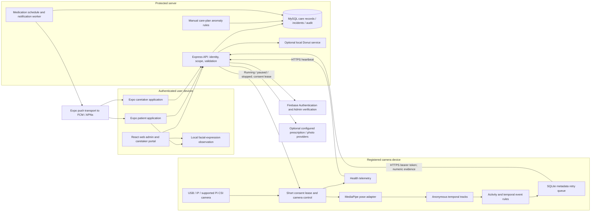
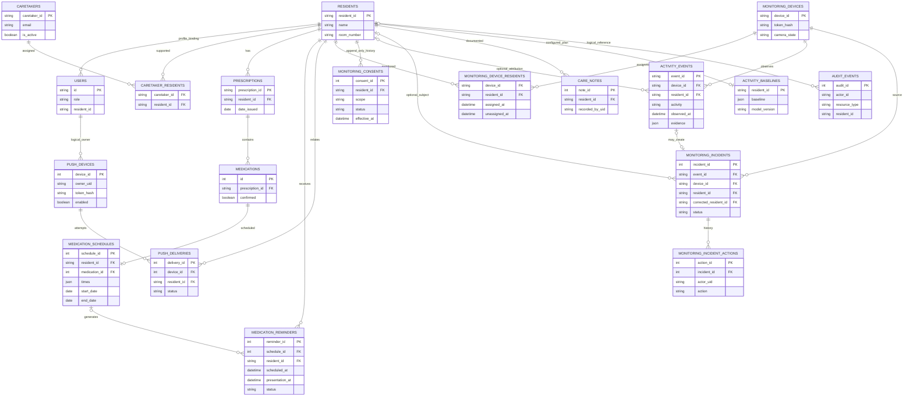
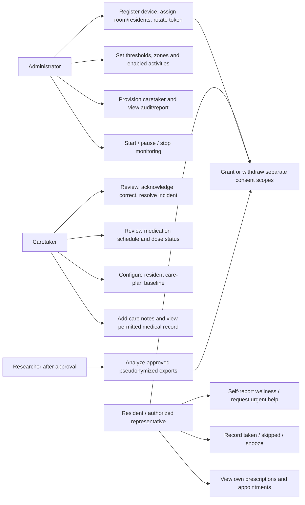
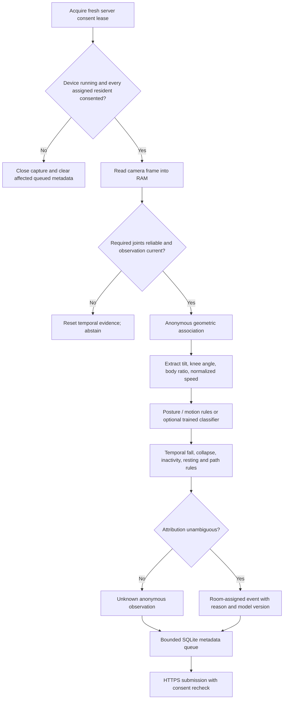
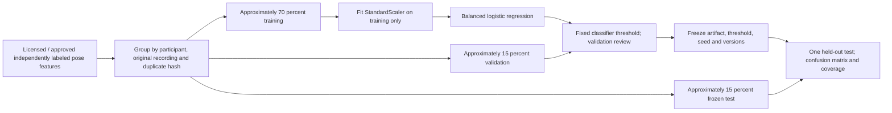

# System architecture and diagrams

The diagrams describe the repository prototype. Cloud calls, push transport and hardware operation require configuration and separate end-to-end evidence. Authoritative implementation contracts are in `4-system-engine/api/schema.sql`, `schema_notifications.sql`, `routes/monitoring.js`, `routes/edge.js`, and `7-monitoring/README.md`.

## Components and trust boundaries



Raw pose frames stay in edge RAM. The camera pipeline stores numeric summaries, timestamps, anonymous track information and permitted room attribution; it does not store video or snapshots. This differs from explicit prescription/photo uploads in other modules, which need their own purpose and handling. Server credentials stay outside client bundles. Device token hashes are stored server-side; the one-time token belongs in the restricted edge environment file.

Camera capture fails closed when consent cannot be refreshed. Previously queued metadata may retry, but internet loss does not authorize continued capture. Queue capacity/expiry are bounded. This privacy choice creates a monitoring gap that staff must recognize and measure.

## Core ER diagram



This is a core relationship diagram, not the entire physical schema. Logical owner/audit/profile bindings do not necessarily have database foreign keys. Also present: appointments, doctors, allergies/conditions within resident fields, emotional self-reports, completed medications, notifications, reminder actions, complaints, meal plans, SOS/wellness alerts, monitoring zones, device health and schema migrations. A nullable resident means unknown; staff correction is recorded separately from the original observation. Consent/audit/incident retention differs from observation retention.

## Use cases



Researchers are a study role, not a broad production API role. Research exports need an approved process and minimum fields; production roles remain admin, caretaker and patient.

## Camera event and incident sequence

```mermaid
sequenceDiagram
  participant Edge as Edge worker
  participant API as Scoped API
  participant DB as MySQL
  participant Push as Push worker
  participant Staff as Caretaker
  Edge->>API: Request device config
  API->>DB: Check device, assignments and active consent
  API-->>Edge: Running state and short lease
  Edge->>Edge: Capture in RAM; pose quality; temporal confirmation
  alt Multiple people or ambiguous assignment
    Edge->>Edge: Keep anonymous / unknown attribution
  else One assigned resident and one observed person
    Edge->>Edge: Apply room-assignment assumption
  end
  Edge->>Edge: Persist metadata with stable event request ID
  Edge->>API: Submit event with numeric evidence
  API->>DB: Recheck consent and scope; idempotent transaction
  DB-->>API: Saved event and eligible incident
  API-->>Edge: Receipt; remove accepted queue item
  Push->>DB: Select relevant incident and permitted recipients
  Push->>Push: Send and later inspect provider receipt
  Staff->>API: Acknowledge / false alarm / correction / resolution
  API->>DB: Record actor, notes, timestamps and audit
```

Provider acceptance does not prove phone receipt, reading or care response. A fall rule candidate creates a reviewable incident; caretaker confirmation is a separate human action. Unknown tracks do not authorize a named critical conclusion.

## Medication sequence

```mermaid
sequenceDiagram
  participant Staff as Authorized staff
  participant API as API
  participant DB as MySQL
  participant Worker as Reminder worker
  participant Phone as Patient phone
  Staff->>API: Confirm source medication; exact schedule
  API->>DB: Save times, weekdays, dates, food instructions
  Worker->>DB: Materialize unique scheduled occurrences
  Worker->>DB: Queue due notification and scoped push
  Worker-->>Phone: Configured Expo transport
  Phone->>API: Taken / skipped / snoozed action
  API->>DB: Lock occurrence; save status/action
  alt Still overdue after configured delay
    Worker->>DB: Queue permitted caretaker escalation
  end
```

Actions record reported adherence, not witnessed ingestion. Occurrence uniqueness prevents duplicate records for the same scheduled time; it cannot physically prevent someone taking a second dose.

## Activity and model pipeline





The classifier supports standing, walking, sitting, lying and resting. It is an optional research baseline, not an implemented I3D/TSN/ST-GCN network. The pose network estimates joints; the temporal rules infer event candidates. Fall performance needs independently labeled full sequences and non-fall observation hours, not frame-level posture accuracy. Emotion and prescription evaluation require their own models, labels and splits.
